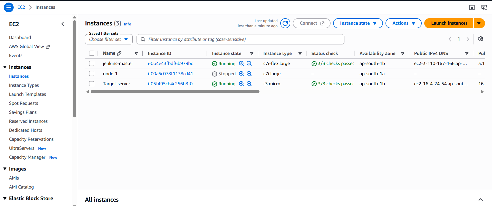
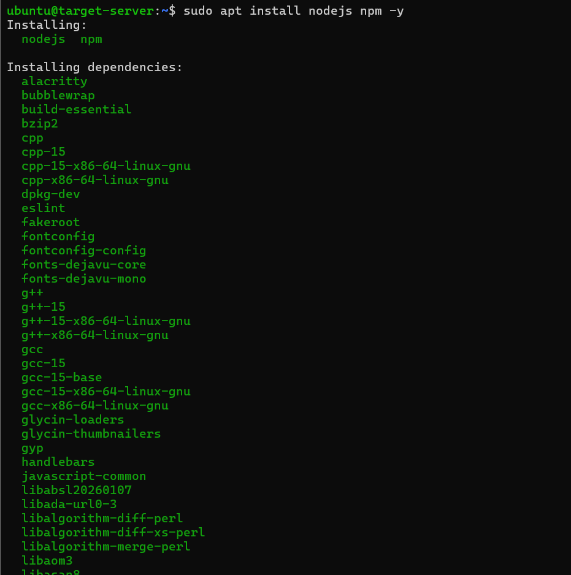
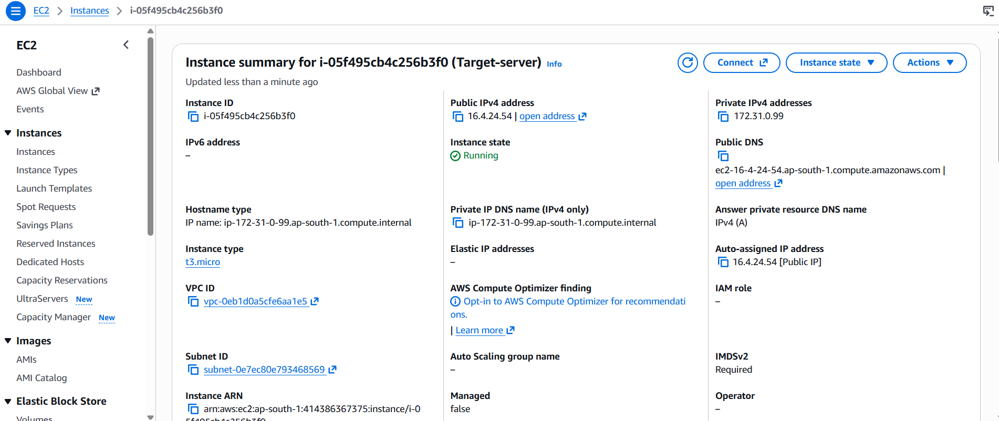
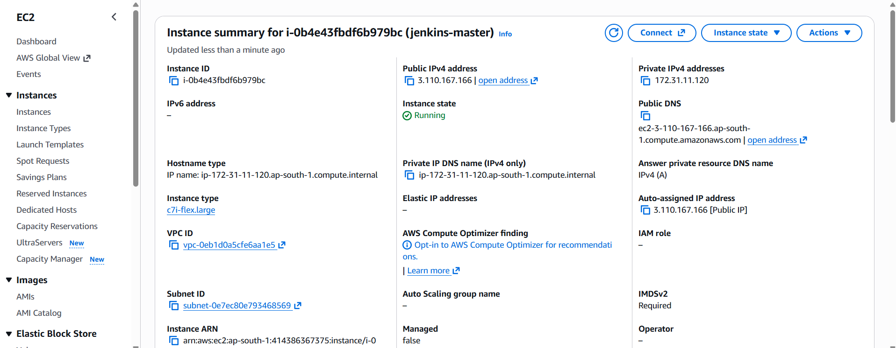
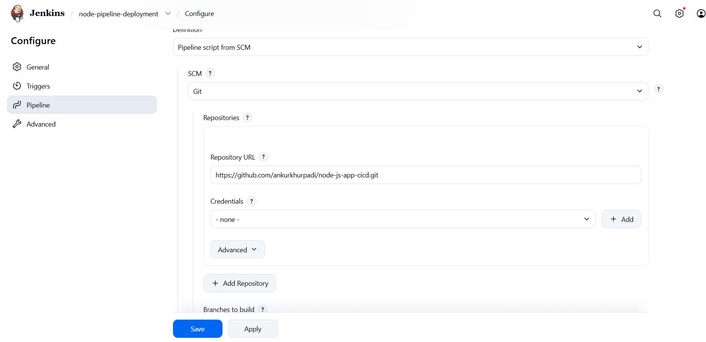
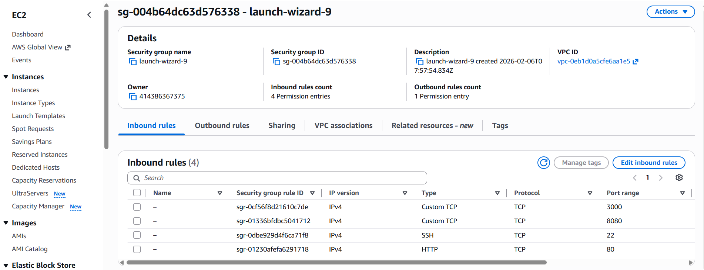
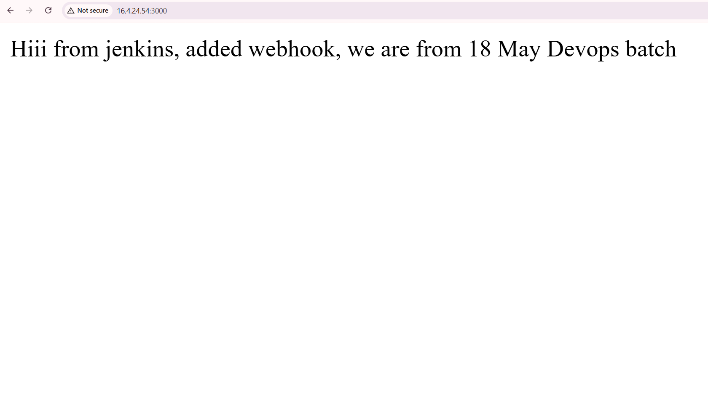

# Node.js Application Deployment using Jenkins CI/CD on AWS EC2

This project demonstrates a basic CI/CD workflow that retrieves a Node.js application from GitHub, transfers the application files to a target EC2 instance over SSH, installs dependencies, and starts the app using PM2.

## Project Overview

- **Source control:** GitHub
- **CI/CD:** Jenkins Pipeline (Jenkinsfile)
- **Application:** Node.js
- **Infrastructure:** AWS EC2 (Jenkins server and target server)
- **Remote deployment:** SSH and SCP
- **Process manager:** PM2
- **Application port:** `3000` (as configured in the lab)

## Architecture

1. The application source code and `Jenkinsfile` are stored in GitHub.
2. Jenkins checks out the repository's `master` branch.
3. Jenkins connects to the target EC2 instance using an SSH credential stored in Jenkins Credentials.
4. Application files are copied to `/home/ubuntu/node-app`.
5. Jenkins runs `npm install` on the target instance.
6. PM2 starts or restarts the Node.js application.
7. Users access the application through the target instance's reachable public address on port `3000`.

> **Branch note:** The repository branch verified for this lab is `master`. Make sure both the Jenkins job's SCM branch and the `BRANCH` value in the Jenkinsfile use `master`.

## Repository Structure

```text
node-js-app-cicd/
├── app.js
├── package.json
├── Jenkinsfile
├── README.md
└── screenshots/
    ├── 01-ec2-instances.png
    ├── 02-nodejs-installation.png
    ├── 03-target-server-details.png
    ├── 04-jenkins-server-details.png
    ├── 05-jenkins-scm-configuration.png
    ├── 06-security-group-rules.png
    └── 07-deployed-nodejs-app.png
```

## Pipeline Stages

### 1. Clone Repository
Jenkins checks out the configured GitHub repository and branch.

### 2. Upload Files to Target Server
Jenkins uses the SSH credential configured as `node-pipeline-key` to connect to the target server and copy the application files to `/home/ubuntu/node-app`.

### 3. Install Dependencies and Start the Application
Jenkins runs `npm install` on the target server, then starts or restarts the process named `node-app` using PM2.

## Prerequisites

- A Jenkins server with Git and the required Pipeline, Git, and SSH Agent plugins.
- A target EC2 instance reachable from the Jenkins server over SSH.
- Node.js and npm installed on the target server.
- PM2 installed on the target server.
- A Jenkins **SSH Username with private key** credential for the `ubuntu` user.
- Security group rules that allow SSH from the Jenkins server and application traffic from intended users.
- A public GitHub repository, or valid Jenkins credentials if the repository is private.

## Configuration Checklist

Review these settings in the Jenkinsfile and Jenkins job before running the pipeline:

- `REPO_URL`: GitHub repository URL.
- `BRANCH`: `master` for this repository.
- `SERVER_IP`: target server's private IP when both instances can communicate over the same VPC/network.
- `SSH_CREDENTIAL`: Jenkins credential ID (do not store the private key in the repository).
- `REMOTE_USER`: `ubuntu`.
- `REMOTE_PATH`: `/home/ubuntu/node-app`.

Do not commit private keys, passwords, access tokens, or other secrets. Prefer validating the target server's SSH host key instead of disabling host-key checking. Restrict inbound SSH and Jenkins access to trusted source IPs or security groups.

## Screenshots

### 1. EC2 Instances


### 2. Node.js and npm Installation


### 3. Target EC2 Server Details


### 4. Jenkins EC2 Server Details


### 5. Jenkins SCM Configuration


### 6. Security Group Rules


### 7. Deployed Node.js Application



## Verify Deployment

On the target EC2 instance, check the process:

```bash
pm2 status
```

Check the application logs if needed:

```bash
pm2 logs node-app
```

Open the app using the target server's current public IPv4 address and port `3000`, for example:

```text
http://<TARGET-PUBLIC-IP>:3000
```

Ensure the application listens on an externally reachable interface (typically `0.0.0.0`) and that the security group allows port `3000` only from the intended sources.

## Current Lab Status

The screenshots document the EC2 setup, Jenkins configuration, deployment pipeline file, security group rules, and an application page in the browser. Capture an additional Jenkins **Console Output** screenshot showing `Finished: SUCCESS` after a successful pipeline run to document the full CI/CD execution.

## Learning Outcomes

- Connecting GitHub source control to Jenkins.
- Writing a Jenkins declarative pipeline.
- Using Jenkins credentials for SSH-based deployment.
- Deploying a Node.js app to EC2.
- Installing dependencies and managing an app with PM2.
- Reviewing AWS networking and security group configuration.
